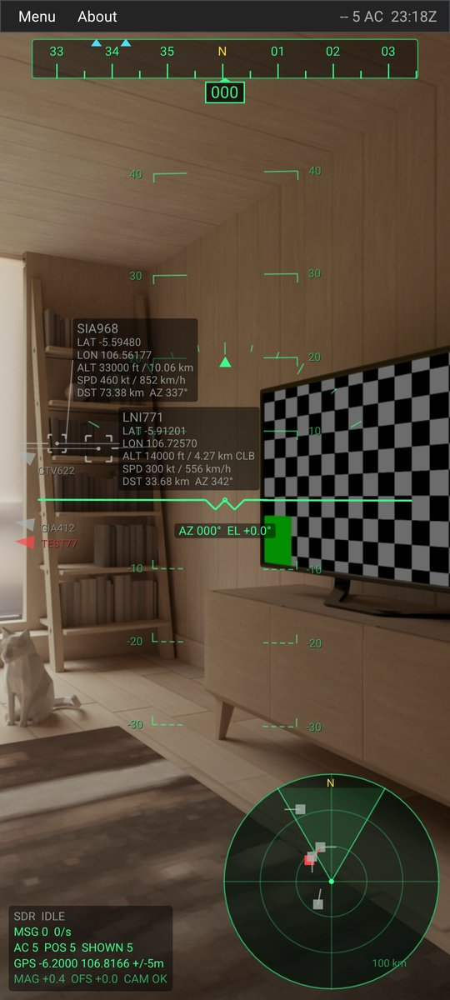
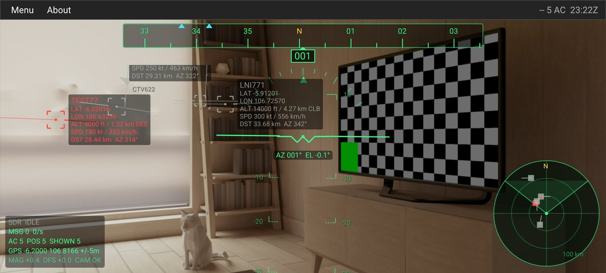
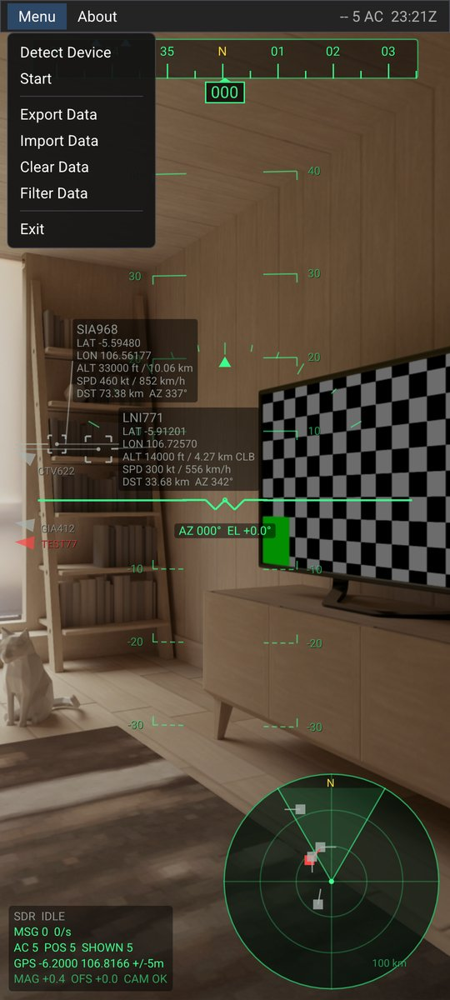
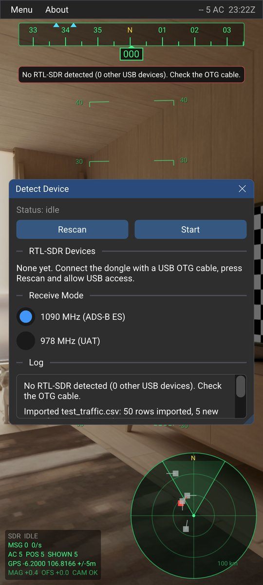
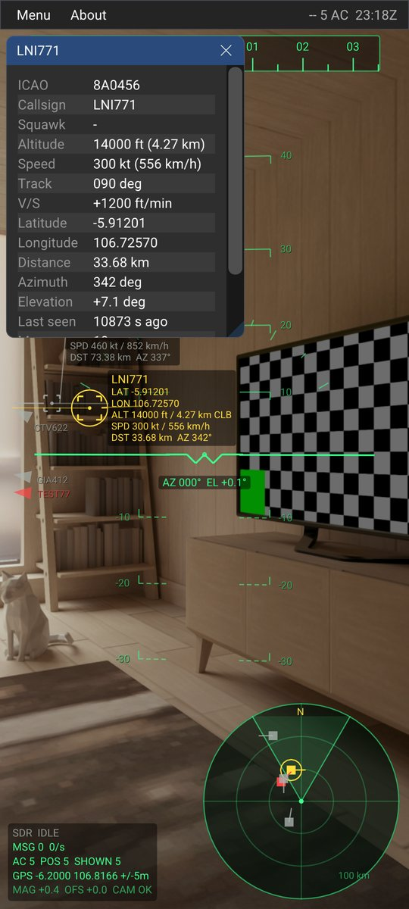
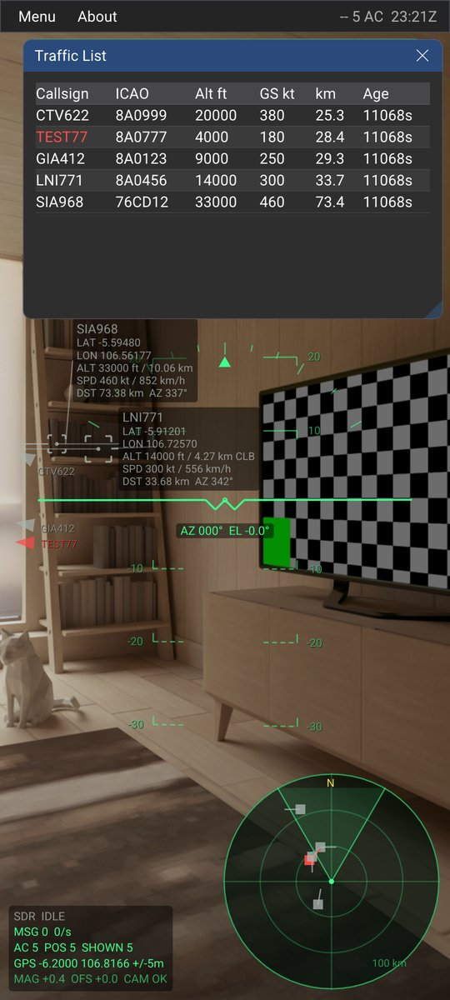
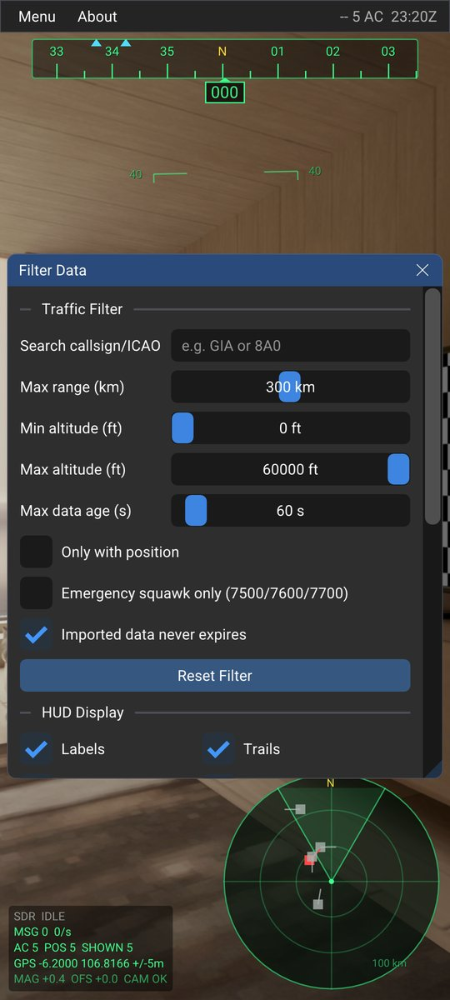
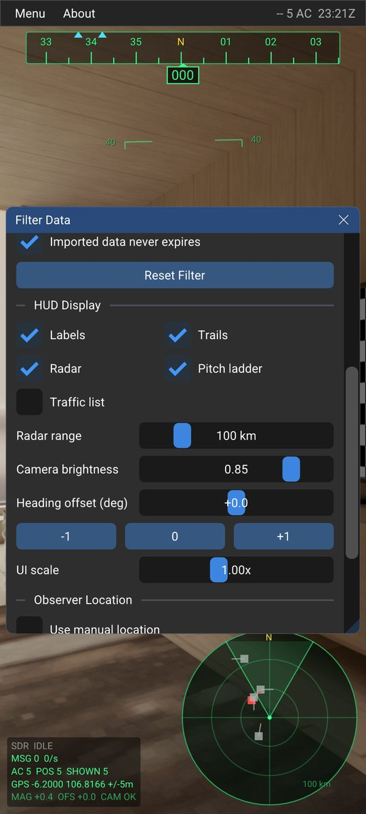
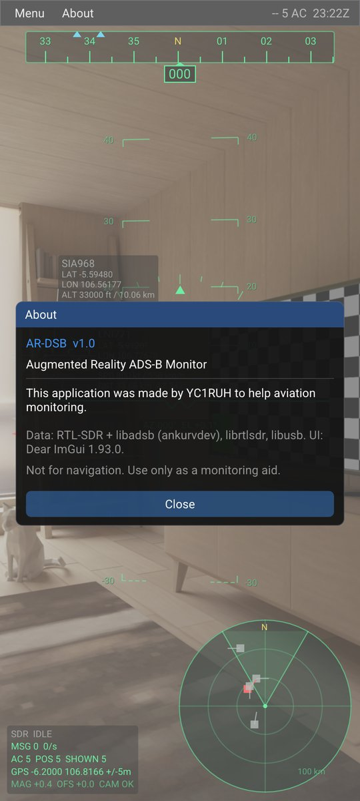
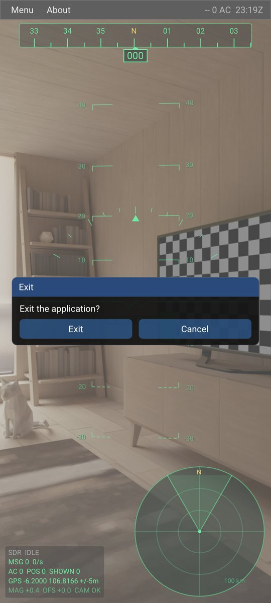

<div align="center">

# AR-DSB

**Augmented Reality ADS-B Monitor for Android**

Live aircraft from an **RTL-SDR** dongle, drawn as an aviation-style **HUD** over the phone camera.

[-3DDC84?logo=android&logoColor=white)](https://developer.android.com/about/versions/oreo)
[](https://developer.android.com/about/versions/16)
[](https://developer.android.com/studio)
[](https://gradle.org)
[](https://developer.android.com/build/releases/gradle-plugin)
[](https://developer.android.com/ndk)
[](https://cmake.org)
<br>
[](https://en.cppreference.com/w/cpp/20)
[](https://openjdk.org/projects/jdk/17/)
[](https://www.khronos.org/opengles/)
[](https://github.com/ocornut/imgui)
[](https://github.com/ankurvdev/libadsb)
[](https://www.rtl-sdr.com)
[](#build)

</div>

---

## Overview

AR-DSB receives **ADS-B 1090 MHz (Mode S Extended Squitter)** or **UAT 978 MHz** messages from an RTL-SDR dongle
connected through USB OTG. It decodes them on the device with
[libadsb](https://github.com/ankurvdev/libadsb) and projects every aircraft onto the camera view. Each aircraft gets
its position, altitude, speed, distance and azimuth. The heading tape, pitch ladder and radar follow the phone's
orientation sensors.

The whole app is native C++ (NativeActivity + OpenGL ES 3 + Dear ImGui). A thin Java layer handles USB permission,
Camera2, sensors, GPS and the Android file picker.

> Made by **YC1RUH** to help aviation monitoring.

## Screenshots

| Screenshot | Description |
|:---:|---|
|  | **AR HUD (portrait)**<br>The camera image with the aviation HUD on top: heading tape, pitch ladder, horizon line and boresight, which reads **AZ** (camera azimuth) and **EL** (elevation). Each aircraft has a bracket and a label with **callsign, LAT, LON, ALT** (ft and km/m), **SPD** (kt and km/h), **DST** (km/m) and **AZ**. Aircraft outside the view are shown as arrows at the screen edge. Bottom: status panel and heading-up radar. |
|  | **AR HUD (landscape)**<br>The layout is recalculated when the phone rotates. Red = emergency squawk (7500/7600/7700). `CLB`/`DES` = climbing/descending. |
|  | **Menu**<br>Detect Device, Start/Stop, Export Data, Import Data, Clear Data, Filter Data and Exit. The right side of the menu bar shows RX state, aircraft count and UTC time. |
|  | **Detect Device**<br>Scans for RTL2832U dongles (42 known VID/PID pairs) and asks for USB permission. You can pick the receive mode (1090 MHz ES / 978 MHz UAT), start or stop reception, and read the event log. |
|  | **Aircraft detail**<br>Tap an aircraft symbol (in AR or on the radar) to see ICAO, callsign, squawk, altitude, speed, track, V/S, position, distance, azimuth, elevation, last seen time, message count and source. |
|  | **Traffic list**<br>A table of the visible traffic, sorted nearest first. Tap a row to select the aircraft. |
|  | **Filter Data: traffic filter**<br>Filter by callsign/ICAO, max range, altitude band and data age. You can also show only aircraft with a position or only emergency squawks. |
|  | **Filter Data: HUD display**<br>Toggle labels, trails, radar, pitch ladder and the traffic list. Set radar range, camera brightness, **heading offset** (compass trim), UI scale and a manual observer location. Settings are saved automatically. |
|  | **About**<br>App information. |
|  | **Exit confirmation**<br>The Android Back button/gesture closes the top window first. It asks for confirmation before leaving the app. |

> Screenshots were taken on the Android Emulator (virtual camera scene) with [`docs/sample_traffic.csv`](docs/sample_traffic.csv)
> imported and the GPS set to Jakarta (-6.2000, 106.8166). The traffic in that file is fictional demo data.

## Features

- **Receive:** RTL-SDR (RTL2832U) through USB OTG, with no root and no external driver app. Supports 1090 MHz ADS-B ES or 978 MHz UAT.
- **AR projection:** WGS-84 → ECEF → ENU relative to the phone's GPS, projected with the rotation-vector sensor and the real camera field of view.
- **True heading:** compass + magnetic declination (`GeomagneticField`) + a user heading offset.
- **HUD elements:** heading tape with traffic bearing markers, pitch ladder, bank scale, boresight AZ/EL readout, traffic brackets and labels, 30-second velocity vectors, flight trails, off-screen arrows, heading-up radar with the camera FOV wedge, and a status panel.
- **Units:** altitude and distance switch automatically between **km** (≥ 1 km) and **m** (< 1 km). Speed is shown in kt and km/h.
- **Data:** export all traffic, including trails, to CSV through the Android save dialog, then import it back later. Clear data with confirmation.
- **Responsive UI:** no ImGui window ever leaves the screen. The UI scale follows screen density and is capped by the shortest screen side. Windows are clamped every frame, including after rotation, and long content scrolls with a finger drag.

## Requirements

| Item | Notes |
|---|---|
| Android phone | Android 8.0+ (API 26). Needs **USB Host/OTG**, a camera, a rotation-vector sensor (gyro + magnetometer) and GPS. |
| RTL-SDR dongle | Any RTL2832U-based dongle (R820T/R820T2/R860, E4000, FC0012/13, FC2580). |
| Antenna | A 1090 MHz antenna gives the best range. The stock whip works for nearby traffic. |
| USB OTG cable/adapter | The dongle draws ~300 mA. Use a powered hub if the phone cannot supply it. |

## Build

| Component | Version |
|---|---|
| Android Gradle Plugin | 9.2.0 |
| Gradle | 9.4.1 |
| compileSdk / targetSdk / minSdk | 36 / 36 / 26 |
| NDK | 28.2.13676358 (`c++_static`) |
| CMake | 3.22.1 |
| Languages | C++20, C, Java 17 |
| Graphics | EGL + OpenGL ES 3.0 |
| UI | Dear ImGui 1.93.0 (Android + OpenGL3 backends) |

## Usage

1. Plug the RTL-SDR into the phone with an OTG adapter. Android may offer to open AR-DSB automatically.
2. Allow **camera** and **location** permissions on first start.
3. Open **Menu → Detect Device** and grant **USB permission**.
4. Pick **1090 MHz** (most regions) or **978 MHz UAT** (USA, below FL180), then press **Start**.
5. Point the phone at the sky. Aircraft appear as soon as position messages arrive.

| Menu | Function |
|---|---|
| **Detect Device** | Scan for RTL-SDR dongles, request USB permission, choose the receive mode and view the log. |
| **Start / Stop** | Start or stop reception. With no device yet, it runs detection and starts automatically after permission is granted. |
| **Export Data** | Save all traffic and trails to a CSV file (`ardsb_YYYYMMDD_HHMMSS.csv`). |
| **Import Data** | Load a CSV exported by AR-DSB, or any CSV with a compatible header. |
| **Clear Data** | Delete all traffic from memory (asks for confirmation). |
| **Filter Data** | Traffic filters, HUD options, heading offset, UI scale and manual location. |
| **Exit** | Leave the application (asks for confirmation). |
| **About** | App information. |

**Touch interactions:** tap an aircraft for details, tap the radar to cycle its range (10/25/50/100/200/400 km), and
press Back to close the top window.

**Compass accuracy:** calibrate the compass (figure-8 motion) if the HUD heading does not match reality. Trim any
remaining error in **Filter Data → Heading offset**.

## CSV format

```csv
time_utc,time_ms,icao,callsign,squawk,lat,lon,alt_ft,speed_kt,heading_deg,vrate_fpm,source
2026-11-06T10:15:02.120Z,1793960102120,8A0456,LNI771,,-5.912010,106.725700,14000,300,90,1200,ADSB1090
```

Import maps columns by header name. It also accepts the aliases `hex`, `flight`, `latitude`/`longitude`/`lng`,
`altitude`/`alt`, `speed`/`gs`, `heading`/`track` and `vrate`/`vert_rate`.

## Third-party software

| Library | Use | License |
|---|---|---|
| [libadsb](https://github.com/ankurvdev/libadsb) | ADS-B 1090 / UAT 978 decoding | no license file upstream (see note) |
| [rtl-sdr (ankurvdev fork)](https://github.com/ankurvdev/rtl-sdr) | RTL2832U driver, `rtlsdr_open_sys_dev` for Android fds | GPL-2.0 |
| [libusb](https://github.com/libusb/libusb) via [libusb-cmake](https://github.com/ankurvdev/libusb-cmake) | USB access (`NO_DEVICE_DISCOVERY` mode) | LGPL-2.1 |
| [dump978 (ankurvdev fork)](https://github.com/ankurvdev/dump978) | UAT decoder (legacy) | see `third_party/libadsb/dump978/LICENSE` |
| [Dear ImGui](https://github.com/ocornut/imgui) | User interface | MIT |

libadsb is vendored at commit `1d5707d` with three small Android stability patches. They are documented in
[`PATCHES.md`](app/src/main/cpp/third_party/libadsb/PATCHES.md).

> **Note:** the upstream libadsb repository does not include a license file. Check with its author before
> distributing binaries publicly. Because rtl-sdr is GPL-2.0, a distributed APK must also comply with the GPL.

## Disclaimer

AR-DSB is a **monitoring aid only**. It is **not a navigation instrument** and must not be used for flight safety or
air traffic separation. ADS-B data can be incomplete, delayed or wrong. Phone sensors (compass, GPS) have limited
accuracy. Altitude is the barometric altitude reported by the aircraft.

## Author

**YC1RUH**: built to help aviation monitoring.
